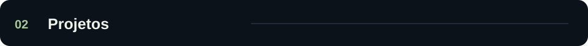
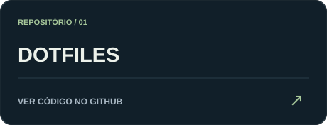
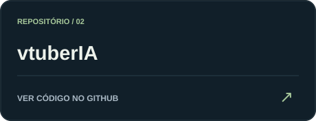
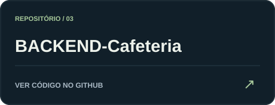
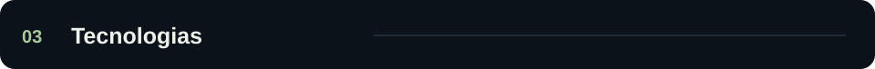

  

<h1 align="center">Kauã Rios</h1>

Estudante de Ciência da Computação

  
  &nbsp;
  

 

## 

Curso **Ciência da Computação** e tenho interesse em desenvolvimento web, Linux e arquitetura de computadores. Aqui compartilho meus projetos e o que venho aprendendo.

Já trabalhei com **Python, C, C++, PHP e JavaScript** nos meus projetos. No momento, estou estudando **Docker** e me aprofundando em **Linux**.

 

## 

  
  
  

<a href="https://github.com/KauaRios?tab=repositories"><strong>Ver todos os repositórios ↗</strong></a>

 

## 

**Linguagens de programação**

**Web e versionamento**

**Estudando atualmente**

 

## Contribuições no GitHub

  

  

 

  

Valeu pela visita!

